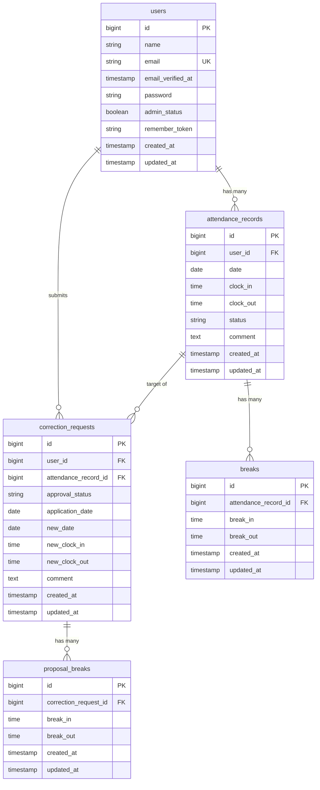

# coachtech 勤怠管理アプリ

ある企業が開発した独自の勤怠管理アプリケーションです。
一般ユーザーの出退勤・休憩打刻、勤怠一覧・詳細確認、打刻修正申請、マイ勤怠レポート機能に加え、管理者によるスタッフ管理・日次/月次勤怠管理・修正申請承認機能、および外部連携用の公開API（v1）を備えています。

---

## 機能一覧

### 一般ユーザー機能
- 新規会員登録 / ログイン / ログアウト（Laravel Fortify）
- メール認証機能（Mailpit）
- 出勤・休憩入・休憩戻・退勤の打刻機能
- 勤怠一覧表示（月別切り替え・詳細遷移）
- 勤怠詳細確認・打刻修正申請
- 修正申請一覧確認（承認待ち / 承認済み）
- マイ勤怠レポート（過去6ヶ月の労働時間サマリー / 月次推移 / 遅刻・早退・長時間労働の異常検知）

### 管理者機能
- 管理者ログイン / ログアウト
- 日次勤怠一覧確認（前日 / 翌日切り替え）
- 勤怠詳細確認・直接修正
- スタッフ一覧確認・スタッフ別月次勤怠一覧確認
- CSV出力機能（スタッフ別月次勤怠データ）
- 修正申請一覧確認・承認機能

### 公開API（v1）
- `GET /api/v1/attendance-records`：勤怠一覧取得（検索・絞り込み・ページネーション対応）
- `GET /api/v1/attendance-records/{attendanceRecord}`：勤怠詳細取得
- `POST /api/v1/attendance-records`：勤怠新規登録（Sanctum認証必須）
- `PUT /api/v1/attendance-records/{attendanceRecord}`：勤怠更新（Sanctum認証・Policy認可必須）
- `DELETE /api/v1/attendance-records/{attendanceRecord}`：勤怠削除（Sanctum認証・Policy認可必須）

---

## テストログイン情報（シーダーデータ）

`php artisan migrate --seed` 実行後に以下のアカウントでログインできます。

| 役割 | 氏名 | メールアドレス | パスワード | 備考 |
| :--- | :--- | :--- | :--- | :--- |
| 一般ユーザー1 | ユーザー1 | `user1@example.com` | `password` | メール認証済み（過去6ヶ月分の勤怠データあり） |
| 一般ユーザー2 | ユーザー2 | `user2@example.com` | `password` | メール認証済み |
| 管理者ユーザー | 管理者 | `user3@example.com` | `password` | メール認証済み（`admin_status = true`） |

---

## 環境構築手順（Docker / Laravel Sail）

### 1. リポジトリのクローン
```bash
git clone https://github.com/atsuko11130530/attendance-app.git
cd attendance-app
```

### 2. 環境設定ファイル（`.env`）の作成
```bash
cp .env.example .env
```

### 3. Dockerコンテナの起動とパッケージインストール
```bash
docker run --rm \
    -u "$(id -u):$(id -g)" \
    -v "$(pwd):/var/www/html" \
    -w /var/www/html \
    laravelsail/php83-composer:latest \
    composer install --ignore-platform-reqs

./vendor/bin/sail up -d
```

### 4. アプリケーションキーの発行とマイグレーション・シーダー実行
```bash
./vendor/bin/sail artisan key:generate
./vendor/bin/sail artisan migrate --seed
```

### 5. フロントエンド資産のビルド
```bash
./vendor/bin/sail npm install
./vendor/bin/sail npm run build
```

### 6. アクセスURL
- **アプリケーションURL（一般ユーザー）**：`http://localhost`
- **管理者ログインURL**：`http://localhost/admin/login`
- **メール確認画面（Mailpit）**：`http://localhost:8025`

---

## 使用技術（実行環境）
- PHP 8.3
- Laravel 10.x（Laravel Fortify / Laravel Sanctum）
- MySQL 8.0
- Nginx
- Docker / Laravel Sail
- Vite / JavaScript / CSS

---

## ER図

